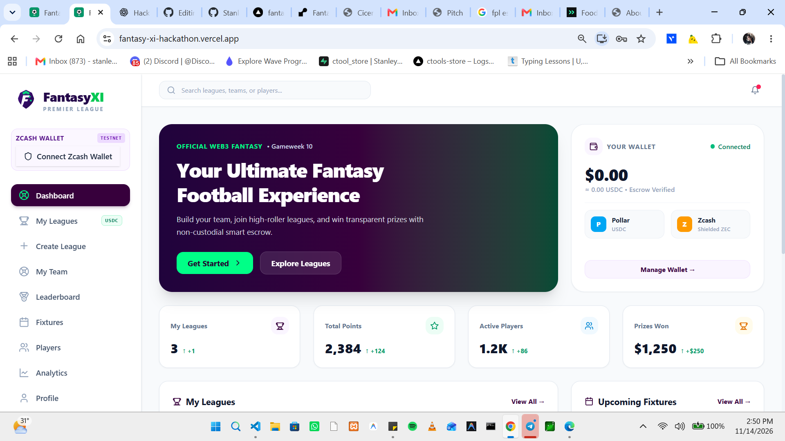
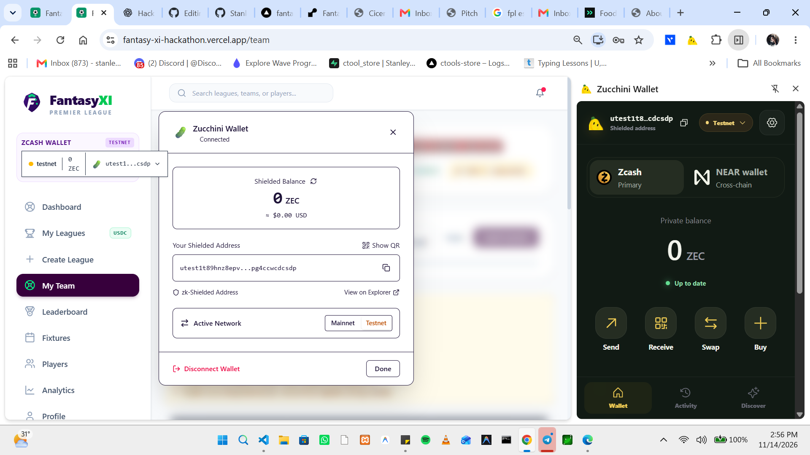

# ⚽ FantasyXI — Play. Compete. Win.

**Fantasy football meets crypto-powered competitions.**

Turn your fantasy football knowledge into real competition. Build your squad, challenge friends, join private leagues and compete for prize pools through crypto-powered payments with a focus on financial privacy.

> **IMPORTANT — PROJECT ORIGIN**
>
> FantasyXI is a **hackathon-focused fork of my own original FantasyXI repository**, created and maintained by **Stanley Obimma-Okonkwo ([@Stanley471](https://github.com/Stanley471))**.
>
> This is not a fork of someone else's project. I created the original FantasyXI and branched this version to independently explore and demonstrate its blockchain-powered competition and Zcash integration without disrupting the original project.
>
> The original project: [Stanley471/FantasyXI](https://github.com/Stanley471/FantasyXI)

---

## The idea

Millions of football fans already compete in fantasy football every season. Over 11 million players are already registered for the 2026/27 FPL season.

They research players, build squads, make transfers, manage budgets, compete with friends and follow weekly rankings. Fantasy football has successfully turned watching football into an interactive competition.

But there is an opportunity beyond points and bragging rights.

**What if fantasy managers could compete for actual rewards without having to rely on manual collections, payment screenshots and trust-based prize distribution?**

That's the idea behind FantasyXI.

## The problem: Fantasy football is competitive, but the money layer is disconnected

Fantasy football communities naturally create private competitions.

Friends, university communities, fan groups and online communities organise leagues with entry fees and prizes. However, running these competitions often introduces problems:

- **Manual collections:** Organisers collect entry fees through separate payment channels.
- **Trust dependency:** Participants must trust someone to hold and distribute the prize pool.
- **Payment disputes:** Screenshots and transfer confirmations can make payment verification difficult.
- **Limited financial privacy:** Public blockchain transactions can expose financial activity to observers.
- **Disconnected experiences:** Fantasy managers use one platform to compete and other services to handle payments.

Fantasy football platforms have made the competition easy. The financial infrastructure around private competitions still has room to improve.

## The opportunity: An enormous existing fantasy football community

Fantasy football is not a niche behaviour. It is an established global community.

The official Fantasy Premier League platform reports **over 11 million players**, demonstrating the scale of interest in fantasy football.

Source: [Official Fantasy Premier League](https://fantasy.premierleague.com/)

This existing audience already understands:
- Building fantasy squads.
- Player prices and budgets.
- Weekly gameweeks and fixtures.
- Points, rankings and league tables.
- Competing against friends and communities.

FantasyXI builds on familiar behaviour rather than asking users to learn an entirely new game.

**Our opportunity is to bring crypto-powered competitions to an audience that already loves competing.**

Initial communities include:
- University and campus fantasy leagues.
- Friends and private football communities.
- Fantasy football content creators and their audiences.
- Online football fan communities.
- Organised fantasy competitions and tournaments.

## The solution: FantasyXI

FantasyXI combines the familiar fantasy football experience with crypto-powered private competitions.

How it works

1. **Build your squad:** Select real football players and manage your fantasy budget.
2. **Create or join a league:** Compete with friends, campus communities or other managers.
3. **Set competition rules:** Configure league entry requirements and prize structures.
4. **Make a payment:** Use the supported crypto payment experience to request and make league-entry payments.
5. **Compete:** Earn points based on real-world football performances and climb the leaderboard.
6. **Win:** Compete for rewards according to the league's rules and prize structure.

The goal is to make private fantasy competitions easier to organise, participate in and manage.

## Why Zcash?

Financial privacy matters when people participate in money-based competitions.

On transparent blockchains, transaction details can be publicly inspected and potentially linked through transaction patterns.

FantasyXI explores **Zcash shielded payments** to provide a more privacy-conscious payment experience.

Zcash brings:

- **Shielded transactions:** Protect transaction details using Zcash's shielded pool.
- **Financial privacy:** Reduce the amount of payment information exposed to public blockchain observers.
- **Payment references:** Associate payment requests with individual league invoices.
- **A privacy-first foundation:** Build financial interactions around user privacy rather than treating it as an afterthought.

FantasyXI integrates the Cicero Zcash developer toolkit for wallet connection and shielded payment request generation.

The integration is designed to support compatible Zcash wallets and Testnet demonstrations.

**Privacy is not just a feature of the payment flow. It is part of the product philosophy.**

Learn more:
- [Zcash](https://z.cash/)
- [Cicero](https://github.com/Kaycee276/cicero)

## What makes FantasyXI different?

| Traditional fantasy platforms | FantasyXI |
|---|---|
| Fantasy squads and points | Fantasy squads and points |
| Private fantasy leagues | Private fantasy leagues |
| Competition and rankings | Competition and rankings |
| External/manual payment arrangements | Integrated crypto payment experience |
| Limited financial privacy in public payment rails | Zcash shielded payment support |

FantasyXI is not trying to replace the fantasy football experience people already enjoy.

It is extending that experience with infrastructure for private, crypto-powered competitions.

## Product highlights

- Fantasy football squads and player selection.
- Player budgets and valuations.
- Gameweek-based competition.
- League creation and management.
- Private team visibility controls.
- League leaderboards and rankings.
- Crypto payment interface.
- Zcash wallet connection.
- ZIP-321 payment request generation.
- Payment QR code generation.

## Technology

| Layer | Technology |
|---|---|
| Frontend | Next.js, React, TypeScript |
| Backend | Node.js, Express |
| Database | PostgreSQL |
| ORM | Prisma |
| Blockchain | Zcash |
| Wallet integration | Cicero Zcash React toolkit |
| Payment format | ZIP-321 |

## Current development status

FantasyXI is an active hackathon project. Some capabilities are implemented, while others remain under development.

| Capability | Status |
|---|---|
| Fantasy squads and player selection | Implemented |
| Fantasy scoring and rankings | Implemented |
| League creation and management | Implemented |
| Private team visibility | Implemented |
| Zcash wallet connection interface | Integrated |
| ZIP-321 payment request generation | Integrated |
| Payment QR generation | Integrated |
| Automated shielded payment detection | Under development |
| Automated payment reconciliation | Under development |
| Automated prize distribution | Planned |

**Important:** Wallet connection and payment request generation do not by themselves mean that a payment has been verified or that funds are held in escrow. Automated payment verification and prize distribution are separate development milestones.

## Roadmap

- [x] Build the fantasy football competition experience.
- [x] Introduce private league functionality.
- [x] Integrate Zcash wallet connection.
- [x] Generate shielded payment requests.
- [ ] Complete automated shielded payment detection.
- [ ] Complete payment reconciliation and membership activation.
- [ ] Develop secure prize distribution.
- [ ] Expand competitions beyond football.

## Vision

FantasyXI starts with football, but the idea extends much further.

Any community built around competition could benefit from private, crypto-powered prize pools.

From campus tournaments to creator communities and global fantasy competitions, we want to make it easier for people to compete, contribute and win.

**Fantasy football is the starting point. Community-powered competition is the bigger vision.**

---

## Built by

**Stanley Obimma-Okonkwo**  
GitHub: [@Stanley471](https://github.com/Stanley471)

Built for the Blockchain UNN Conference 5.0 Hackathon.

---

*FantasyXI — Play. Compete. Win.*